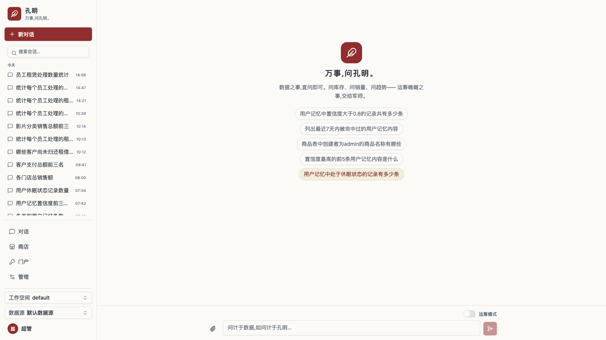
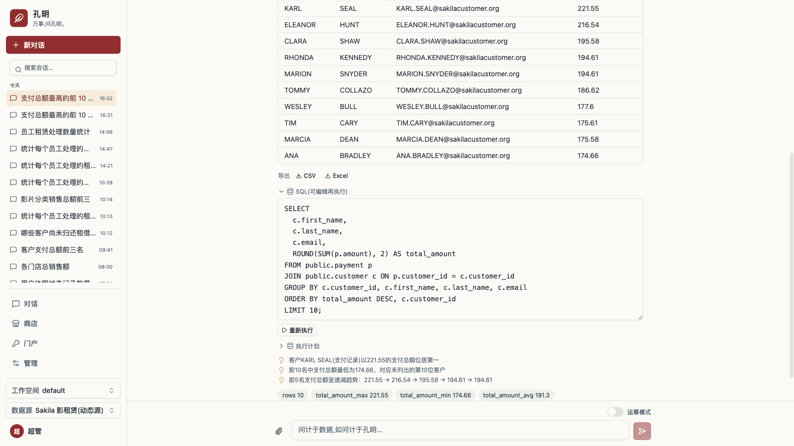
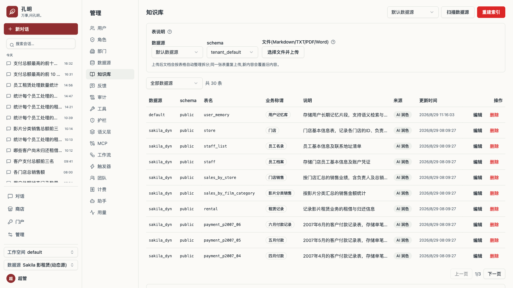
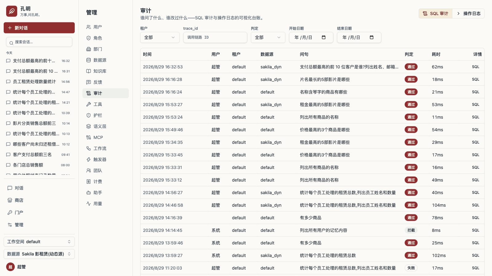
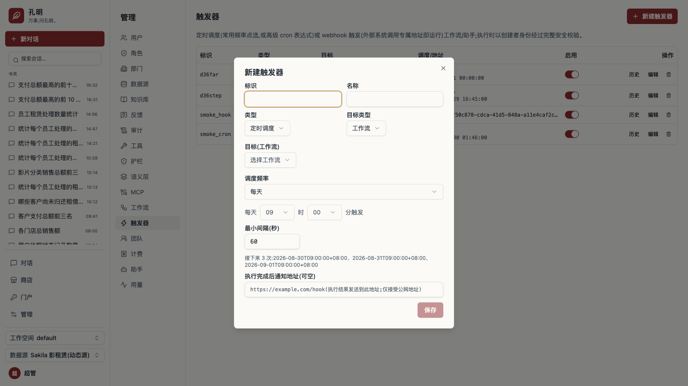
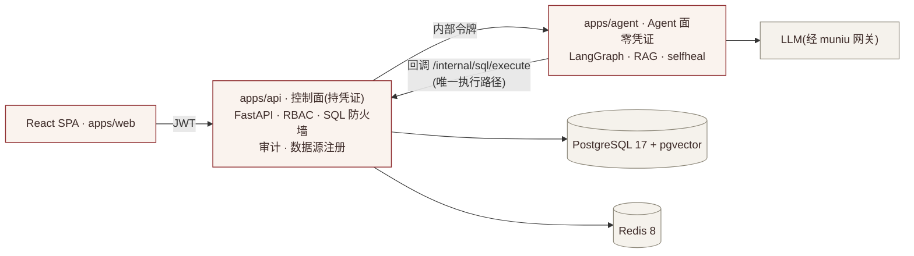

# Kongming · 孔明

> 万事,问孔明。
> 全能 AI Agent 助手:数据问答与分析(NL → SQL → 洞察)是首发王牌场景。
> 品牌:[docs/brand.md](docs/brand.md) · Crafted by Solvela(漆阳帆)

[](docs/tech-stack.md)

## 界面速览

### 问数:自然语言 → SQL → 图表 → 洞察

问一句人话,得到带图表的结果:每条 SQL 全透明、可编辑再执行,支持柱状/折线/面积/散点切换、CSV/Excel 导出,并附洞察解读与统计摘要;答不上来时如实说明,不会编造数据。


| 空态即入口:按租户与数据源生成建议问题                  | 过程全透明:SQL 可编辑、可重新执行                      |
| ------------------------------------------------------ | ------------------------------------------------------ |
|  |  |

### 知识与护栏:让 Agent 答得准、行得正

| 知识库:表业务术语 + 文档上传,双路增强     | 护栏:注入拦截 / PII 脱敏 / 输出防护                | 审计:每次执行留痕,判定与耗时可查              |
| ----------------------------------------- | -------------------------------------------------- | --------------------------------------------- |
|  |  |  |

### 运营与开放:用量可算、调度可靠

| 模型用量:调用 / Token / 延迟按任务拆解        | 触发器:档位式定时调度或 webhook,预览未来执行                 | 登录:Keycloak OIDC 统一身份           |
| --------------------------------------------- | ------------------------------------------------------------ | ------------------------------------- |
|  |  |  |

## 为什么是孔明:把 NL→SQL 当生产系统做

开源的 text-to-SQL 生态大多以「能出数」为目标;孔明选择把多租户生产环境当成第一约束,押三件多数项目没有认真做的事:

### 1. SQL 安全纵深(五层,层层独立成立)

LLM 生成的 SQL 不可信,所以它进库前要连闯五关,每一层都不依赖上一层:

| 层            | 机制                                                                                                                                                                              |
| ------------- | --------------------------------------------------------------------------------------------------------------------------------------------------------------------------------- |
| AST 防火墙    | [sqlglot](https://github.com/tobymao/sqlglot) 解析为 AST 后做只读根白名单(SELECT/UNION/子查询)、嵌套写/DDL 拦截、危险函数拒用(pg_read_file/pg_sleep/dblink…)——AST 白名单,不是正则 |
| schema 白名单 | 跨租户/跨 schema 引用直接 BLOCKED(`tenant_b.t` 不可见)                                                                                                                            |
| 保留表拒读    | 控制面表(`sys_*`/`chat_*`/RAG 元数据)拒读,含 CTE 遮蔽绕过防护                                                                                                                     |
| 行级权限      | `data_scope` 以 **AST 改写**注入最外层 WHERE(明确立约:AST 非字符串拼接),参数化绑定                                                                                                |
| 连接级只读    | 执行连接 `default_transaction_read_only=on`,防火墙之上的最后一道闸                                                                                                                |

每次执行留审计(判定、耗时、租户、用户);agent 自愈重试遇权限/防火墙拦截直接终止不重试,省 LLM 配额。

### 2. 信任边界 = 进程边界

Agent 进程里**不存在任何数据库凭证**——import-linter 在 CI 里强制 agent 禁止 import 任何 DB 驱动(ADR-002)。Agent 只能经内部令牌回调控制面唯一执行入口;SQL 执行只发生在持凭证的控制面,且必过上述五层。

### 3. 诚实评估,不报喜数

内置 NL2SQL 评估集([apps/api/evals/](apps/api/evals/)):黄金指标 Execution Match(生成的 SQL 直连执行,与链路响应结果集做严格/宽松双分),评估器以真实用户路径跑完整链路,`persist=false` 不污染业务库。**2026-08-30 基线:单轮宽松 50/50、严格 35/50(2 题负例不计严格分)、多轮 12/12、动态数据源 4/4**——严格口径如实呈现,因为安全约束下的诚实基线比宽松高分更接近生产真相。

关于语义层:业界共识已转向 metrics/语义层(统一口径防幻觉),孔明当前取的是「schema 白名单 + 知识库术语增强 + 成功 SQL few-shot 自学习」路线——不引入独立语义层服务,把口径知识收进 RAG 知识库与召回管线。这是一个清醒的取舍而非疏忽:独立语义层是下一阶段候选项,当前栈以最少 moving parts 先把安全与评估闭环做实。

## 架构一页纸



**RAG 三路召回 + RRF 融合**:pgvector 向量路(schema/文档语义)+ PostgreSQL 全文路 + 成功 SQL few-shot 路(query_history 自动回写,问过答对的沉淀为少样本),三路倒排融合取 top5;召回零命中回退实时 schema 内省。知识覆盖优先级:内省 < AI 润色 < 上传 < 人工编辑 < 用户反馈。

决策记录:[docs/adr/](docs/adr/) | 技术栈宪法:[docs/tech-stack.md](docs/tech-stack.md) | 行为契约:[openspec/specs/](openspec/specs/)(41 个能力域)

## 快速开始

```bash
cp .env.example .env          # 填 KM_DB_PASSWORD / KM_INTERNAL_TOKEN / KM_AGENT_LLM_API_KEY
mise install                  # python 3.13 + node 24(或自备)

# 基础设施
docker compose -f infra/docker-compose.yml up -d postgres redis

# 完整栈镜像(build context = 仓库根,060 修复路径依赖)
docker build -f infra/api.Dockerfile -t kongming-api:dev .
docker build -f infra/agent.Dockerfile -t kongming-agent:dev .
# 或:docker compose -f infra/docker-compose.yml up -d --build api agent

# 控制面(含 Alembic baseline 建库)
cd apps/api && uv sync && uv run alembic upgrade head
uv run uvicorn kongming.main:app --port 8000

# Agent 面(另开终端;注意它没有也不需要任何 DB 配置)
cd apps/agent && uv sync
uv run uvicorn kongming_agent.main:app --port 8001

# 前端(另开终端)
cd apps/web && pnpm install && pnpm dev   # http://localhost:5173
```

## 常用命令

```bash
make check        # 全量门禁:静态/测试/契约/死代码/重复/依赖/配置 lint
make contracts    # 导出 OpenAPI → 生成前端类型(提交前必跑)
make up / down    # compose 基础设施
```

## 路线图

对话问答(RAG 三路召回 / 多轮指代消解)→ 反馈精修闭环 → 动态数据源 →
云沙箱分析(NL2Insight)→ 工具调用 / MCP → Agent 市场。

LLM 接入走自研网关 [muniu](../muniu/)(单二进制 Go 网关,计量计费与 failover 在网关层闭环)。
